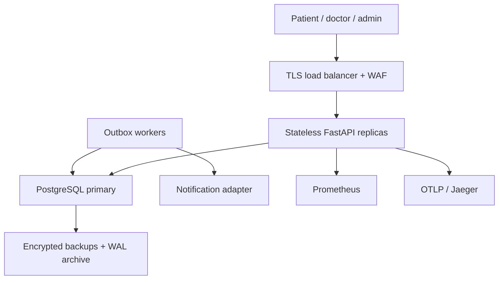
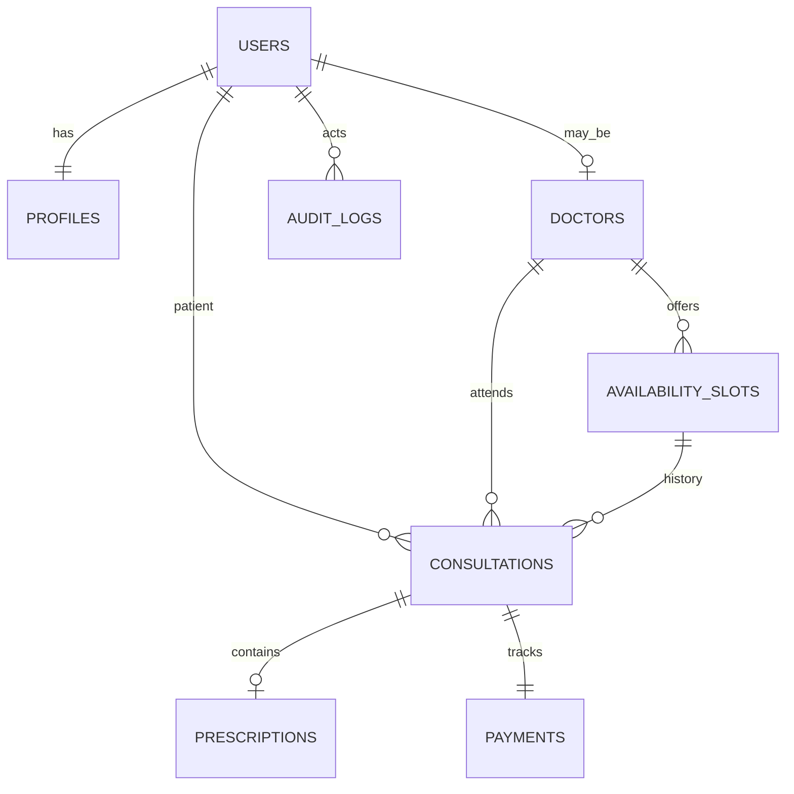

# Architecture — Amrutam

Designed as a roughly 2–4 page architecture narrative; diagrams are Markdown/Mermaid.

## 1. Boundaries and data flow

The modular monolith is the deployable API unit. Typed route modules depend on a
request-scoped SQLAlchemy session; shared security and transaction helpers keep policy
consistent. PostgreSQL is the authoritative store. Workers process durable outbox rows.
A monolith keeps the critical booking transaction within one database and reduces
operational complexity in the 4–5 day assignment window. API and worker replicas can scale separately.



Edge, WAF, managed HA database and backup are production architecture components;
Compose implements API, database, worker, Prometheus and Jaeger. The delivery adapter
is a log-only synthetic notification. OpenTelemetry excludes health/metrics endpoints.
Request logs contain route templates, correlation IDs, status and latency, not payloads.
No video calling, real gateway, clinical validation or external identity provider is included.

## 2. Booking correctness

```mermaid
sequenceDiagram
  participant P as Patient
  participant A as API
  participant D as PostgreSQL
  participant W as Worker
  P->>A: POST consultation + token + idempotency key
  A->>A: Authenticate, role check, validate
  A->>D: Begin; advisory lock on scoped key
  alt Same key and same request already committed
    D-->>A: Stored response
  else New request
    A->>D: SELECT slot FOR UPDATE
    A->>D: Check future slot / active booking
    A->>D: Insert consultation, pending payment, audit, outbox, key
    A->>D: Commit transaction
  end
  A-->>P: Consultation ID
  W->>D: Claim outbox FOR UPDATE SKIP LOCKED
  W->>W: Deliver with stable delivery ID
  W->>D: Mark delivered / schedule retry
```

PostgreSQL READ COMMITTED plus a slot row lock serializes competing bookings. A partial
unique index on slot_id for all non-cancelled consultations is an independent database
backstop. The cancellation and rebooking race is safe: an early competitor may receive
409 and retry; it cannot create duplicate active bookings. Doctor slot creation uses a
per-doctor transaction advisory lock and an interval overlap query. All slot writes use
that path. Direct SQL writers must follow the same rule or add an exclusion constraint.

Idempotency keys are scoped to the account and globally reusable only for the same
operation/body. A transaction advisory lock serializes identical keys; request fingerprints
reject different bodies. Durable responses are written in the same commit as business
changes. PostgreSQL constraints protect integrity even if application checks are bypassed.
No cache is trusted for booking correctness. Idempotency key length is 8–128 characters;
clients should use UUIDs. Retries after a timeout replay the committed result.

## 3. Data model and ownership



`users`: normalized unique email, Argon2 password hash, server-managed role and encrypted
MFA secret. `profiles`: name. `doctors`: specialty, integer fee in paise. Slots use UTC-aware
instants. Consultations have booked → in_progress → completed or booked → cancelled.
A prescription is required to complete the local workflow and is immutable after issue.
Only the assigned doctor writes it; only participants read clinical records. Admins see
aggregate analytics and metadata audit logs, not prescriptions. Payment rows are local
pending/cancelled ledgers; no funds move. Audit actor IDs also support the operator sentinel.

Support tables provide idempotency replay, PostgreSQL-backed shared rate limits and outbox
jobs. Audit inserts commit with domain writes; a PostgreSQL trigger denies UPDATE/DELETE.
Ownership, clinical authorization and immutable audit metadata are separate concerns.

## 4. Capacity, storage and latency

100,000 consultations/day is about 1.16 new consultations/second on average; a working
capacity hypothesis is 20x peak (~23 bookings/second), plus searches, reads and lifecycle
writes. These are assumptions, not benchmark results. Load test realistic read/write mixes
and both contended and uncontended slots before choosing replicas and connection limits.
p95 objectives are reads <200 ms and writes <500 ms; WAN and third-party latencies must be
budgeted separately. Password hashing is deliberately expensive and should have its own SLO.

Indexes cover slot doctor/time, consultation patient/doctor/status, specialty and audit time.
Pagination is capped at 100; offset pagination is adequate for a demo. Use cursor pagination
for deep histories, EXPLAIN ANALYZE on realistic data and precomputed aggregates for large
admin reports. Avoid adding microservices before measuring bottlenecks.

No Redis cache is enabled in this implementation: responses include sensitive data or
rapidly changing availability. A production option is a short-TTL public doctor directory
cache keyed by search filters, invalidated on doctor updates. Never cache clinical responses
at shared proxies or use cached availability as a reservation guarantee.

Partition high-volume audit and delivered-outbox data by month after measuring table sizes.
Consultation partitioning must preserve the global active-slot uniqueness rule: keep a
small reservation table keyed by slot_id if time partitions would break that invariant.
Do not partition blindly by date and lose cross-partition booking integrity. Tenant-based
sharding is a later option; this assignment has no tenant boundary.

## 5. Failure handling, sagas and availability

Business changes, audit, pending payment and outbox commit atomically, so no distributed
saga is needed for the implemented local transaction. Worker delivery is at-least-once:
a crash after external delivery but before commit may redeliver. A real provider must
honor the stable outbox delivery ID. Exceptions trigger exponential backoff with jitter,
a one-hour ceiling and a dead state after eight failures. Operator replay requires diagnosis.

For a real gateway use a booking/payment saga: hold slot with expiry, request payment
with an external idempotency key, consume signed/deduplicated webhook, confirm booking;
on failure/timeout release the hold and refund an already captured payment. No gateway
call should run inside a database row-lock transaction. This saga is documented, not built.

Clients retry network errors and 502/503/504 using bounded exponential backoff and jitter,
and preserve idempotency keys for writes. A 409 occupied-slot conflict needs another slot;
a 429 honors Retry-After. Do not blindly retry authentication/validation errors.

The 99.95% availability target allows roughly 21.6 minutes/month (30-day month). Production
needs multiple API replicas/zones, managed PostgreSQL failover, connection pooling, readiness
checks, rolling updates and tested restore procedures. Compose is single-host, with no HA.
Kubernetes template, backup plan, incident guidance and key rotation are in OPERATIONS.md.
